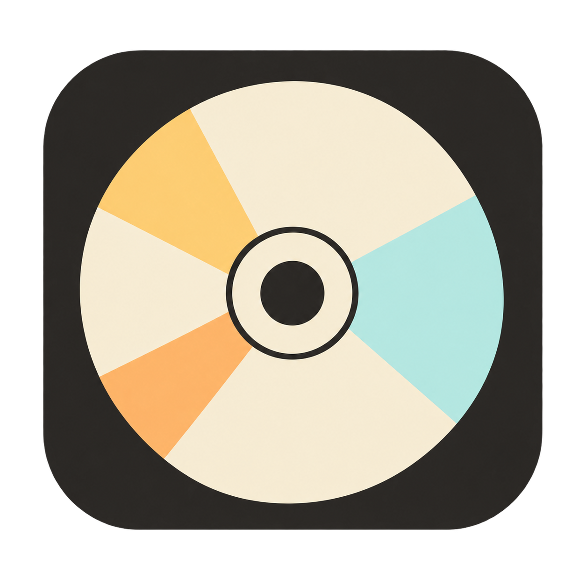

# NeoDisc · Take time for music



[简体中文](README.zh-CN.md)

A modern CD player and ripper for Windows and macOS, built with Rust, Tauri and React.

Current version: **0.1.1**.

## Current features

- Frameless window with integrated controls, a track list and a persistent playback bar.
- Three skins with light and dark variants, system appearance and scheduled night mode.
- English and Simplified Chinese, following the system language by default. A manual language choice takes effect immediately and is saved locally.
- CD playback, pause, previous/next track, seeking, volume and repeat. Press Space to play or pause.
- Selectable audio output, automatic switching with the system default, device refresh and reconnection.
- Live 10-band playback EQ with a draggable frequency/gain curve in dB, preamp gain and seven presets (Flat, Bass boost, Vocal, Pop, Rock, Classical and Jazz). Save, recall, update, rename or delete your own presets, with undo for deletion. Settings are saved locally; EQ does not affect ripped files.
- Automatic album and track identification through MusicBrainz with CUETools DB as a fallback, plus Cover Art Archive artwork. Only unambiguous exact matches are applied. Lookup status and retry are available on the CD page; automatic lookup can be disabled in Preferences. Album information can also be edited locally.
- A details icon on each track opens album and track metadata, including year, genre, disc number, label, composer, rating and comments, plus the original CD audio properties. Unavailable fields are shown as unknown.
- FLAC and WAV extraction preserving the original 44.1 kHz, 16-bit stereo audio.
- MP3 and AAC-LC/M4A extraction with sample rate, bitrate and channel settings. MP3 also supports CBR, ABR, VBR and encoding precision. Each format remembers its settings and offers quality presets.
- Tags and artwork in FLAC, MP3 and M4A, plus playlists and rip reports with source PCM hashes.
- Background ripping with progress, optional repeated-read comparison and cancellation. Existing output files are preserved.
- Rip history with folder availability checks, individual deletion, bulk cleanup and undo. Removing history keeps audio files.
- Bundled audio encoder; no separate FFmpeg installation is required.

## Usage

On Apple Silicon Macs, download `*_aarch64.dmg`; Intel Macs use `*_x64.dmg`. macOS packages include a complete ad-hoc signature but are not Developer ID signed or notarized. If macOS blocks the first launch, use **System Settings → Privacy & Security → Open Anyway** for NeoDisc after trying to open it. Version 0.1.1 fixes the incomplete app-bundle signature in 0.1.0.

1. Open the desktop app, connect a CD drive and insert an audio CD. Refresh the drive list if needed. On macOS, wait for the audio CD to appear in Finder first.
2. Click **Play all** or double-click a track. Search filters the current disc's tracks. Use the details icon at the right of a track to inspect its metadata and audio properties.
3. Album information is identified automatically in the background. **Identify again** retries without stopping playback and bypasses cached misses. Use **Preferences → Identify CD information automatically** to enable or disable online lookup; the choice is remembered. Only the disc ID / track layout is sent, never audio. The databases may not contain every CD. Use **Edit info** to change album and track text.
4. Select tracks, choose FLAC, WAV, MP3 or AAC and an output folder. For MP3 or AAC, open **Encoding settings** to adjust the parameters, then click **Start ripping**.
5. Open **Rip history** to find completed exports. Missing folders are marked and can be cleaned up together; deletion can be undone.
6. Use **Appearance** for skins and night mode, and **Preferences** for language, audio output and EQ. Choose an EQ preset to enable it, then drag curve points or use arrow keys to adjust each band. Double-click a point to reset it to 0 dB. Use **Save preset** to name your settings and recall them from **My presets**. If playback becomes silent after changing devices, try **Reconnect output**.

Ripping uses the CD drive and pauses playback. The default output folder is `NeoDisc` inside your system Music folder. MP3 and AAC are lossy formats; increasing the sample rate does not add detail to the original CD audio.

## Development and building

Requirements: Node.js 24 and Rust stable. Windows also needs MSVC build tools and WebView2; macOS needs Xcode command-line tools. The minimum configured macOS version is 12.

```sh
npm ci
npm run desktop
```

The first desktop run prepares the bundled encoder and requires an internet connection. Windows downloads a fixed, SHA-256-verified build; macOS builds the encoder from pinned sources.

Build the Windows installer on Windows:

```sh
npm run package -- --bundles nsis
```

Build a DMG on macOS:

```sh
npm run package -- --bundles dmg
```

Packages are written to `src-tauri/target/release/bundle`. A portable Windows copy must keep `NeoDisc.exe`, `ffmpeg.exe` and the `encoders` folder together.

## Validation

```sh
npm run prepare:encoder
npm run check:version
npm test
npm run build
npm run test:ui
cargo test --manifest-path src-tauri/Cargo.toml --lib --locked
cargo clippy --manifest-path src-tauri/Cargo.toml --all-targets --locked -- -D warnings
```

Browser tests use Edge on Windows and Playwright Chromium elsewhere. Install Chromium with `npx playwright install chromium` before running those tests on macOS or Linux.

Release builds also mount each macOS DMG and check the complete app signature, both executable architectures, bundled resources, MP3/AAC encoding and decoding, and application startup. Run `node scripts/verify-macos-package.mjs <dmg> <target>` on macOS to repeat these checks.

Automated checks cover themes, language selection and persistence, audio routing, EQ frequency response and live changes, preset persistence, metadata, history cleanup, encoding settings, tags, artwork, decoding and cancellation. Windows playback and ripping have also been tested with a physical USB CD drive. macOS optical-drive behavior still needs testing on physical hardware.

Repeated-read comparison may use drive or system caches; it is not AccurateRip verification.
